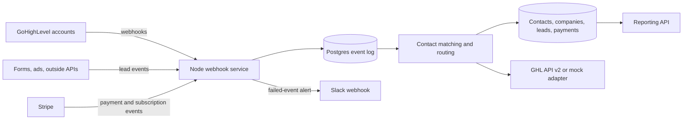

# GoHighLevel Multi-Account Hub POC

A small, local proof of concept for collecting lead and payment events into PostgreSQL. It demonstrates contact matching, rule-based routing, event retries/replay, and basic reporting. Outbound GHL contact sync supports both a local mock and the GHL API v2 contact upsert/update endpoints.

> **POC limitations:** `GHL_MODE=mock` is the safe default and sends no GHL requests. Real API calls require a location token with the `contacts.write` scope and a valid account/location mapping. Incoming GHL payloads use the example shape below, not an account-verified native webhook format. Email verification, HighLevel import APIs, and company association APIs are not called. Company names are linked locally in Postgres. Do not expose this service publicly or use it for production data.

## Architecture



See the [account addition guide](./docs/adding-an-account.md) for the short onboarding checklist.

## Run locally

Requirements: Node.js 20+ and Docker Compose.

```sh
cp .env.example .env
npm install
docker compose up -d
npm test
npm start
```

The service creates its tables on startup and listens on `http://localhost:3000`. In another terminal, check `curl http://localhost:3000/health` to verify the database connection. Docker maps Postgres to port `55432` by default; `.env.example` already contains the matching `DATABASE_URL`.

Stop the service with `Ctrl+C`; stop the local database with `docker compose down`. The named Docker volume keeps the database data. `docker compose down -v` deletes that data, so only use it when you intentionally want to reset the local POC database.

## Switch mock sync to real GHL

The adapter uses the GoHighLevel API base URL and the API version header configured in `.env`. The defaults target the v2 contact endpoints (`POST /contacts/upsert` and `PUT /contacts/{contactId}`). Before turning on real sync, get collaborator access and a test location from the account owner. Use a location-scoped Private Integration access token with the contact write permission needed by that account. Never put a real token in source code, `routing.json`, or a committed file; `.env` is ignored by Git.

1. Keep the service in mock mode while preparing the account. In the GHL sub-account/location, create or obtain an approved Private Integration token. Confirm its contact write permission and use a test location/contact first.
2. In `.env`, map every destination `account_id` used in [`config/routing.json`](./config/routing.json) to that account's GHL location ID and the name of its token environment variable. Add a token variable for each separate location/token:

   ```dotenv
   GHL_ACCOUNT_CONFIG_JSON={"brand-a":{"locationId":"YOUR_LOCATION_ID","tokenEnv":"GHL_TOKEN_BRAND_A"}}
   GHL_TOKEN_BRAND_A=YOUR_PRIVATE_INTEGRATION_ACCESS_TOKEN
   ```

   For multiple locations, add one JSON entry and token variable per internal account ID. For example:

   ```dotenv
   GHL_ACCOUNT_CONFIG_JSON={"brand-a":{"locationId":"LOCATION_A","tokenEnv":"GHL_TOKEN_BRAND_A"},"brand-b":{"locationId":"LOCATION_B","tokenEnv":"GHL_TOKEN_BRAND_B"}}
   GHL_TOKEN_BRAND_A=TOKEN_FOR_LOCATION_A
   GHL_TOKEN_BRAND_B=TOKEN_FOR_LOCATION_B
   ```

3. Check `GHL_API_BASE_URL` and `GHL_API_VERSION` in `.env`. Leave the supplied defaults unless the client's GHL app requires a different supported version. Keep `GHL_REQUEST_TIMEOUT_MS` positive, and leave `MAX_RETRIES` at its default initially.
4. Change `GHL_MODE=mock` to `GHL_MODE=real`, save `.env`, and restart `npm start` so the process loads the new settings. Do not expose this unauthenticated POC server to the public internet.
5. Send one test lead to `POST /webhooks/form` using the sample below, with a unique `event_id` and a test email/phone. The `account_id` in the matching routing rule must have a GHL account mapping. This form/ads lead path is what triggers outbound contact sync.
6. Confirm the response has `"status":"processed"`, check `GET /sync-logs` for `"outcome":"synced"`, and verify the contact in the expected GHL location. Also resend the same event once to check webhook deduplication.
7. If anything is wrong, set `GHL_MODE=mock` again and restart the service. Inspect `GET /events?status=failed` and the service logs before retrying or replaying.

With no saved GHL contact ID for that account, the adapter uses `POST /contacts/upsert` with the mapped `locationId`. When `account_contacts` already has that account's GHL contact ID, it uses `PUT /contacts/{contactId}` instead. The returned ID is stored against that master-contact/account pair, so the next sync updates the same GHL contact. The initial local master-contact merge only fills empty fields; the GHL upsert can update a matched GHL contact according to the location's duplicate-contact settings. Verify those settings before using real data. Mock remains the default. A `429` response honors `Retry-After` (capped to one minute); transient network, timeout, and server errors use `MAX_RETRIES`. Client errors such as invalid credentials/permissions are not retried.

Switching from mock to real only affects events processed after the switch; it does not automatically sync all existing master contacts. Historical backfill should be a separate, reviewed operation after live test results are approved.

## Send a sample lead

The POC accepts a small normalized event envelope. A client-specific adapter will be needed to map the actual GHL webhook payload into this shape after account access is available.

```sh
curl -X POST http://localhost:3000/webhooks/form \
  -H 'content-type: application/json' \
  -d '{
    "event_id": "form-event-001",
    "event_type": "lead.created",
    "data": {
      "external_id": "form-lead-001",
      "lead_source": "google_ads",
      "location": "Austin",
      "service_type": "plumbing",
      "contact": {
        "email": "jane@example.com",
        "phone": "(512) 555-0100",
        "first_name": "Jane",
        "last_name": "Doe",
        "company_name": "Example Services"
      }
    }
  }'
```

The sample route sends Austin plumbing leads from Google Ads to `brand-a` / `new-leads`. Routing rules are in [`config/routing.json`](./config/routing.json); more specific matches take precedence over wildcard matches.

## Webhook event shapes

- `POST /webhooks/ghl` — use `event_type: "contact.updated"` or `event_type: "lead.created"`, `account_id`, and `data.contact`. Include `data.ghl_contact_id` when known.
- `POST /webhooks/form`, `/webhooks/ads`, `/webhooks/external` — use `event_type: "lead.created"` and the lead fields shown above.
- `POST /webhooks/stripe` — send a Stripe event envelope with `id`, `type`, and `data.object`. For payment and subscription events, the object must include `metadata.account_id` and contact email/phone (metadata or Stripe customer details). A subscription object must also include `status`.

When `STRIPE_WEBHOOK_SECRET` is set, Stripe's `Stripe-Signature` is checked, including a five-minute timestamp tolerance. Without it, the local POC accepts unsigned Stripe-shaped requests; keep that mode local only.

Contact matching is case-insensitive on trimmed email and based on phone digits. Existing non-empty contact values are preserved. If the event's email and phone point to two different contacts, processing fails for manual review instead of merging them. A company is linked by normalized company name.

## Inspect and replay

| Endpoint | Purpose |
| --- | --- |
| `GET /contacts` | List contacts and locally linked company names |
| `GET /leads` | List routed leads with account and pipeline |
| `GET /events?status=failed` | Find failed events and their latest errors |
| `POST /events/{event-uuid}/replay` | Retry a failed event (up to `MAX_RETRIES` attempts) |
| `GET /sync-logs` | See outbound GHL sync results (`simulated` or `synced`) |
| `GET /reports/summary` | Lead counts, converted leads, and successful payment revenue |

New events are persisted before processing. Processing failures are retried up to `MAX_RETRIES` times (default 3), then retained as failed. If `SLACK_WEBHOOK_URL` is configured, the service sends an alert with the account, source, event ID, and error. Duplicate deliveries with the same source and event ID are not processed twice. The GHL adapter honors `Retry-After` on rate-limit responses; real rate-limit behavior still needs validation with the client's account.

## POC boundaries / next validation steps

1. Get collaborator access and representative webhook examples for each GHL account; confirm available scopes, native triggers, API limits, contact import, email verification, and association features.
2. Configure the API adapter using the steps above and test with a non-production contact first. Map real webhook payloads and confirm the account/location and pipeline IDs.
3. Confirm field ownership and merge rules with the client. This POC only fills missing contact values; it intentionally does not reconcile conflicting non-empty values.
4. Configure and test Stripe signatures, account mapping, refunds, and subscription lifecycle behavior against test-mode events.
5. Add authentication, authorization, privacy controls, production-grade monitoring, backups, and migrations before handling real data.
6. Connect Metabase or Looker Studio to the reporting queries. The dashboard itself is not included in this POC.
7. Add a read-only MCP interface only after access controls and permitted data fields are agreed.

The architecture is: GHL/forms/ad platforms/Stripe -> webhook intake -> durable Postgres event record -> contact matching and routing -> local master tables and mock/real GHL contact sync -> reporting queries. Postgres rows retain account-specific contact associations as well as the shared contact record.
